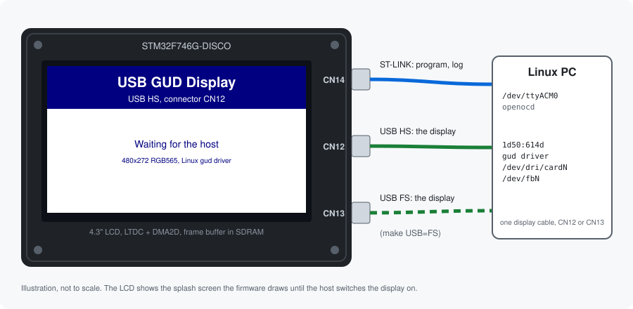

# STM32 USB GUD Display

**Turn the LCD of an STM32F746G-Discovery board into a USB monitor for Linux.**

<p align="center">
  
</p>

The board speaks [GUD (Generic USB Display)](https://github.com/notro/gud/wiki), a
small protocol for USB displays. The Linux kernel has had a driver for it, `gud`, since
5.13. Plug the board in and Linux sees a 480x272 monitor: it gets a DRM device, a
framebuffer `/dev/fbN`, shows up in `modetest`, and a desktop like GNOME can extend onto
it. No driver or software needs to be installed on the PC.

```
usb 1-5.4.3.1: new high-speed USB device number 17 using xhci_hcd
usb 1-5.4.3.1: New USB device found, idVendor=1d50, idProduct=614d, bcdDevice= 2.00
usb 1-5.4.3.1: Product: GUD Display in HS Mode
usb 1-5.4.3.1: Manufacturer: STMicroelectronics
[drm] Initialized gud 1.0.0 for 1-5.4.3.1:1.0 on minor 0
gud 1-5.4.3.1:1.0: [drm] fb1: guddrmfb frame buffer device
```

The display was first prototyped in software, as the
[GUD display example](https://freand76.github.io/usbip-server/usb_gud_display_device.html)
of [usbip-server](https://github.com/freand76/usbip-server), which runs USB devices as
ordinary Linux programs over USB/IP. This repository moves that device onto real
hardware. What was learned there, about the protocol and about GNOME, is collected
below.

| | |
|---|---|
| Board | [STM32F746G-DISCO](https://www.st.com/en/evaluation-tools/32f746gdiscovery.html) (STM32F746NG, Cortex-M7 at 216 MHz, 4.3" 480x272 LCD, 8 MB SDRAM) |
| Display | 480x272, RGB565, 60 Hz mode |
| USB | High Speed on CN12 (external ULPI PHY) or Full Speed on CN13, chosen when building |
| USB id | `1d50:614d`, the id the Linux `gud` driver binds to |
| Speed | 30 full frames per second at High Speed (7.8 MB/s, measured) |
| Host | Linux 5.13 or later with the `gud` driver (`CONFIG_DRM_GUD`) |
| Firmware | STM32CubeF7 v1.17.4: HAL, BSP and the ST USB Device library |

## Contents

- [What You Need](#what-you-need)
- [Repository Layout](#repository-layout)
- [Building](#building)
- [Flashing](#flashing)
- [Connecting the Board](#connecting-the-board)
- [Testing on Linux](#testing-on-linux)
- [GNOME](#gnome)
- [How It Works](#how-it-works)
- [Changing the Display](#changing-the-display)
- [Troubleshooting](#troubleshooting)
- [Licenses](#licenses)

## What You Need

- An **STM32F746G-Discovery** board.
- **Two USB cables** that carry data, not only power:
  - one for the ST-LINK, connector **CN14**: programming, power and a serial log,
  - one for the display, connector **CN12** (High Speed) or **CN13** (Full Speed),
    both micro-AB.
- A **Linux PC**, x86-64. The scripts download the toolchain for x86-64 Linux; on other
  hosts install an `arm-none-eabi` toolchain and OpenOCD yourself.
- On the PC: `git`, `make`, `curl`, `tar` with `xz` support and `sha256sum`. On Debian
  and Ubuntu:

  ```
  $ sudo apt install git make curl xz-utils coreutils
  ```

- For the test scripts: Python 3.9 or later and [uv](https://docs.astral.sh/uv/), which
  fetches each script's dependencies by itself:

  ```
  $ curl -LsSf https://astral.sh/uv/install.sh | sh
  ```

- Optionally, for testing: `ffmpeg` and `modetest` (`sudo apt install ffmpeg libdrm-tests`).

## Repository Layout

The firmware is laid out like an example application of an STM32Cube package, and the
GUD class looks like the other classes of the ST USB Device library:

```
Makefile                                        builds, flashes, downloads the toolchain
STM32CubeF7/                                    git submodule, STM32CubeF7 v1.17.4
Middlewares/ST/STM32_USB_Device_Library/
  Class/GUD/Inc/usbd_gud.h                      GUD class: protocol, descriptors, API
  Class/GUD/Src/usbd_gud.c                      GUD class: requests and pixel data
Projects/STM32746G-Discovery/Applications/USB_Device/GUD_Display/
  Src/main.c                                    clocks, MPU, LCD, splash screen, log
  Src/usbd_gud_if.c                             the display: draws received rectangles
  Src/usbd_conf.c, Src/usbd_desc.c              USB low level driver and descriptors
  Src/stm32f7xx_it.c, Src/system_stm32f7xx.c    interrupts and system startup
  Src/syscalls.c                                printf to the ST-LINK serial port
  Inc/                                          headers, HAL configuration
  GCC/STM32F746NGHx_FLASH.ld                    linker script
  readme.txt                                    the application, in ST's format
scripts/                                        Python scripts for testing on Linux
tools/                                          toolchain download scripts
udev/                                           udev rules for the ST-LINK and GNOME
```

## Building

### 1. Clone the repository

```
$ git clone https://github.com/freand76/stm32-usb-gud-display.git
$ cd stm32-usb-gud-display
```

### 2. Check out STM32CubeF7

STM32CubeF7 is a submodule, fixed at release **v1.17.4**. It has submodules of its own,
for every board and component ST supports. The build only needs a few of them, so don't
clone recursively; `make submodules` checks out exactly what the build uses (the HAL,
CMSIS, the STM32746G-Discovery BSP and its LCD, touch, audio and flash components):

```
$ make submodules
```

This takes a minute, most of it for STM32CubeF7 itself. To check:

```
$ git submodule status
 e5939c26775f313f376b68c80c2a212a795a2993 STM32CubeF7 (v1.17.4)
```

### 3. Download the toolchain

```
$ make toolchain
```

This downloads two tools into `toolchain/` in the repository, checks their SHA-256
sums, and installs nothing system wide:

| Tool | Version | From |
|---|---|---|
| Arm GNU Toolchain, `arm-none-eabi` | 15.2.Rel1 | [developer.arm.com](https://developer.arm.com/downloads/-/arm-gnu-toolchain-downloads) |
| xPack OpenOCD | 0.12.0-7 | [github.com/xpack-dev-tools](https://github.com/xpack-dev-tools/openocd-xpack/releases) |

The Makefile uses `toolchain/current/bin/arm-none-eabi-gcc` when it exists, and the
`arm-none-eabi-gcc` on your `PATH` otherwise, so you can also use a toolchain you
already have. `toolchain/` is in `.gitignore`. To download a single tool:
`tools/fetch_toolchain.sh` or `tools/fetch_openocd.sh`.

### 4. Build

Choose the USB core with `USB=HS` (the default) or `USB=FS`:

```
$ make                   # High Speed, the display cable goes into CN12
$ make USB=FS            # Full Speed, the display cable goes into CN13
```

Each core is built in its own directory, so both builds can exist side by side:

```
build/HS/GUD_Display_HS.elf   .bin   .hex   .map
build/FS/GUD_Display_FS.elf   .bin   .hex   .map
```

A successful build ends with the memory usage:

```
LD build/HS/GUD_Display_HS.elf
Memory region         Used Size  Region Size  %age Used
           FLASH:       41536 B         1 MB      3.96%
             RAM:        9184 B       320 KB      2.80%
```

Other options:

| Command | What it does |
|---|---|
| `make -j8` | builds in parallel |
| `make OPT="-O0 -g3"` | builds without optimization, for debugging. Run `make clean` first, objects are not rebuilt when only the flags change |
| `make clean` | removes `build/` |

What `USB` selects:

| | `USB=HS` | `USB=FS` |
|---|---|---|
| Connector | CN12 | CN13 |
| OTG core | OTG_HS with the USB3320 ULPI PHY | OTG_FS with its internal PHY |
| Bulk packets | 512 bytes | 64 bytes |
| Define | `USE_USB_HS` | `USE_USB_FS` |
| Product string | GUD Display in HS Mode | GUD Display in FS Mode |

## Flashing

### With OpenOCD (recommended)

OpenOCD talks to the ST-LINK directly, which needs access rights to the ST-LINK's USB
device. Install the udev rule once:

```
$ make install-udev
```

This copies [udev/49-stlink.rules](udev/49-stlink.rules) to `/etc/udev/rules.d/` and
reloads udev. Unplug the ST-LINK cable and plug it in again. Then:

```
$ make flash             # builds and flashes the High Speed firmware
$ make flash USB=FS      # builds and flashes the Full Speed firmware
```

OpenOCD programs, verifies and resets the board:

```
** Programming Finished **
** Verify Started **
** Verified OK **
** Resetting Target **
```

Without the udev rule OpenOCD fails with `LIBUSB_ERROR_ACCESS`.

### With the ST-LINK drive

The ST-LINK also shows up as a USB drive, `DIS_F746NG`. Copying a `.bin` file to it
programs the board, and needs neither OpenOCD nor the udev rule:

```
$ make flash-msd [USB=FS]
```

`make flash` does this by itself when no OpenOCD is found. The older ST-LINK firmware on
many boards leaves the drive read only after one programming cycle
(`Filesystem has been set read-only` in the kernel log). Mount it again before the next
copy, `/dev/sdX` being the drive:

```
$ udisksctl unmount -b /dev/sdX && udisksctl mount -b /dev/sdX
```

### Check that it runs

The LCD shows a splash screen with the selected USB core:

```
USB GUD Display
USB HS, connector CN12
Waiting for the host
```

## Connecting the Board

1. **CN14, ST-LINK**: powers the board, programs it, and carries the log.
2. **CN12** for a `USB=HS` build or **CN13** for a `USB=FS` build: the display. Only
   one of them is used, the splash screen names the right one.

Use cables that carry data. A charge-only cable on CN12 lights the board and powers the
USB PHY, but the PC never sees the display: nothing at all appears in the kernel log.

Watch the kernel log while plugging in the display cable:

```
$ journalctl -k -f
```

About 10 seconds after the device appears, the framebuffer follows
(`fb1: guddrmfb frame buffer device`). See [The connector](#the-connector) for why it
takes that long.

## Testing on Linux

The [scripts/](scripts/) are [PEP 723](https://peps.python.org/pep-0723/) scripts, run
with `uv run`, which installs their dependencies by itself. None of them need root.

| Script | What it does |
|---|---|
| [gud_check.py](scripts/gud_check.py) | checks everything from the ST-LINK to the framebuffer, and says what to fix |
| [serial_log.py](scripts/serial_log.py) | prints the firmware's log from the ST-LINK serial port |
| [fb_activate.py](scripts/fb_activate.py) | switches the display's framebuffer on |
| [fb_animation.py](scripts/fb_animation.py) | draws animated demo effects: plasma, tunnel, fire |

### Access rights

The framebuffer belongs to the `video` group and the serial port to `dialout`. Add
yourself to both and log in again:

```
$ sudo usermod -aG video,dialout $USER
```

### 1. Check the setup

```
$ uv run scripts/gud_check.py
ST-LINK (CN14)
  ok    STM32 STLink 0483:374b
  ok    /dev/bus/usb/001/016 is writable, OpenOCD can program the board
  ok    log on /dev/ttyACM0, read it with 'uv run scripts/serial_log.py'

GUD display (CN12 for USB=HS, CN13 for USB=FS)
  ok    GUD Display in HS Mode at High Speed, port 1-5.4.3.1
  ok    bound to the gud driver
  ok    /dev/dri/card0, connector card0-USB-1: connected, modes 480x272
  ok    framebuffer /dev/fb1 is writable
  ok    GNOME ignores the display (71-gud-mutter-ignore.rules), draw on it yourself

Everything looks fine. Draw on the display with:
  uv run scripts/fb_animation.py
```

Each failed check comes with a hint, and the script exits with status 1.

### 2. Follow the log

In a second terminal:

```
$ uv run scripts/serial_log.py
Reading /dev/ttyACM0 at 115200 baud, Ctrl-C to stop
18:00:01 USB: configured
18:00:02 Display: controller enabled
18:00:02 Display: 480x272, format 0x40
18:00:02 Display: output enabled
18:00:06 Display: 30 updates, 7833600 bytes, last 480x272 at 0,0, 0 errors
```

- `controller` and `output` follow the host switching the display on and off.
- `480x272, format 0x40` is the mode the host set, `0x40` is RGB565.
- Updates are summed up once a second. A full frame is 261120 bytes.

Any terminal program works too, at 115200 8N1: `picocom -b 115200 /dev/ttyACM0`.

### 3. Draw on the display

These programs need the display to themselves. On GNOME, install the udev rule of the
[GNOME](#gnome) section first, or GNOME uses the display as a monitor.

**Demo effects**, at 30 frames per second by default, until Ctrl-C:

```
$ uv run scripts/fb_animation.py
$ uv run scripts/fb_animation.py --effect tunnel --fps 20
```

**ffmpeg**. The kernel only shows the framebuffer once its mode has been set, so switch
it on after each plug in. The script prints which framebuffer the display has:

```
$ uv run scripts/fb_activate.py
/dev/fb1: 480x272, 16 bits per pixel, switched on
$ ffmpeg -re -f lavfi -i testsrc2=size=480x272:rate=30 -pix_fmt rgb565le -f fbdev /dev/fb1
$ ffmpeg -re -f lavfi -i mandelbrot=size=480x272:rate=15 -pix_fmt rgb565le -f fbdev /dev/fb1
```

**modetest**, straight through DRM, colour bars until Enter:

```
$ modetest -M gud -c                            # find the connector id, for example 38
$ modetest -M gud -s 38:480x272@RG16
$ modetest -M gud -s 38:480x272@RG16 -F tiles,tiles
```

Other fill patterns are `smpte`, `gradient`, `plain` and `noise`.

The framebuffer only shows while no other program, like `modetest` or the desktop,
drives the display. When the host switches the display off, the splash screen comes
back.

## GNOME

**On GNOME, plugging the display in again after it was unplugged can make GNOME Shell
crash or ignore the display: mutter never forgets a display that was unplugged.**
Resetting or reflashing the board unplugs the display too, so during development this
happens all the time.

These are mutter issues, found while prototyping the display with usbip-server, where
attaching and detaching is as quick as starting a program:

- [mutter#710](https://gitlab.gnome.org/GNOME/mutter/-/work_items/710): mutter never
  removes an unplugged GPU, and a GUD display is a GPU of its own.
- [mutter#4963](https://gitlab.gnome.org/GNOME/mutter/-/work_items/4963): when the
  display comes back under the same `/dev/dri/cardN`, mutter logs
  `Failed to hotplug secondary gpu '/dev/dri/cardN': device already present`, and the
  next monitor configuration crashes GNOME Shell (signal 11 in
  `meta_kms_device_get_planes`). When the old device node is still held open, by
  Xwayland for example, the display gets a new node, is added as a new GPU and works.
- [mutter#4617](https://gitlab.gnome.org/GNOME/mutter/-/work_items/4617): a hotplugged
  display whose connector is already connected is listed by mutter, but never gets a
  monitor and stays dark. mutter only creates the monitor when the connector status
  *changes*; a hotplug event without a change is ignored.

Two ways to work with this:

- **Use it as a desktop monitor:** plug the display in once per session. After it was
  unplugged, log out and in before plugging it in again. It shows up in the display
  settings about 10 seconds after it is plugged in, and the desktop extends onto it.
- **Keep GNOME away from it:** install
  [udev/71-gud-mutter-ignore.rules](udev/71-gud-mutter-ignore.rules) before the display
  is plugged in for the first time in a session. GNOME then never uses the display, it
  can be plugged in and out freely, and `modetest`, `ffmpeg`, the scripts or your own
  programs can draw on it:

  ```
  $ sudo install -m 644 udev/71-gud-mutter-ignore.rules /etc/udev/rules.d/
  $ sudo udevadm control --reload-rules
  ```

  The rule tags the display's DRM device:

  ```
  SUBSYSTEM=="drm", KERNEL=="card[0-9]*", ATTRS{idVendor}=="1d50", ATTRS{idProduct}=="614d", TAG+="mutter-device-ignore"
  ```

  `scripts/gud_check.py` tells you whether the tag is set. To use the display as a
  monitor again, remove the rule and log out and in.

### The connector

For mutter#4617 the firmware reports the display's connector as **disconnected for the
first 5 seconds** after the host configures the device, and connected after that. The
kernel polls the connector every 10 seconds, sees the change, and mutter creates the
monitor. That is why the display shows up about 10 seconds after it is plugged in. The
delay is `GUD_CONNECTOR_CONNECT_DELAY_MS` in
[usbd_gud_if.h](Projects/STM32746G-Discovery/Applications/USB_Device/GUD_Display/Inc/usbd_gud_if.h).
Until then the kernel logs `[drm] Cannot find any crtc or sizes`, which is expected.

## How It Works

### The GUD protocol

The protocol is specified by the kernel header
[include/drm/gud.h](https://github.com/torvalds/linux/blob/master/include/drm/gud.h).

- The `gud` driver binds to vendor specific interfaces with a few fixed ids, so the
  display uses `1d50:614d`, the original GUD id, and not an id of ST's.
- The host asks the display about itself with vendor control requests to the
  interface: the display descriptor (size limits, flags, largest transfer), the pixel
  formats, the properties (rotation 0 is mandatory), the connector, its status and its
  modes.
- To change the mode, the host sends the new state with `GUD_REQ_SET_STATE_CHECK` and
  applies it with `GUD_REQ_SET_STATE_COMMIT`, then switches the controller and the
  output on.
- Pixels arrive on one bulk OUT endpoint. Before each transfer, `GUD_REQ_SET_BUFFER`
  says which rectangle it updates and how long it is.
- A control OUT request can not be rejected once its data has arrived, so the display
  sets `GUD_DISPLAY_FLAG_STATUS_ON_SET`: the host follows every SET request with
  `GUD_REQ_GET_STATUS` and the display only has to remember how the last request went.
  Requests the display doesn't support are stalled, and the host then reads the status
  too.

### The firmware

- The class in
  [usbd_gud.c](Middlewares/ST/STM32_USB_Device_Library/Class/GUD/Src/usbd_gud.c)
  answers the requests and checks every rectangle against the display and the
  committed format. The application describes the display and receives the state
  changes and the rectangles through `USBD_GUD_ItfTypeDef`, like the CDC class's
  interface.
- The OTG core counts at most 1023 packets per transfer, so the class receives each
  rectangle in chunks of 32 KB.
- Pixel data is received into SDRAM. The display announces a full frame, 261120 bytes,
  as its largest transfer, so the host sends a full screen update in one transfer.
- [usbd_gud_if.c](Projects/STM32746G-Discovery/Applications/USB_Device/GUD_Display/Src/usbd_gud_if.c)
  copies each rectangle into the LCD frame buffer with DMA2D, in the USB interrupt.
  The LTDC shows the frame buffer, an RGB565 layer at `0xC0000000`.
- The MPU configures the SDRAM as write-through: the CPU writes the received pixels,
  DMA2D and the LTDC read them from memory, past the data cache.
- The main loop prints the log, and draws the splash screen whenever the host switches
  the display off. It disables the USB interrupt while it draws, because both use
  DMA2D.

### Speed

At High Speed the display takes 30 full frames per second, 7.8 MB/s, which was the frame
rate `fb_animation.py` asked for. Full Speed is limited by its 12 Mbit/s bus to about
1 MB/s, roughly 3 to 4 full frames per second. A desktop mostly sends the rectangles
that changed, which are much smaller.

## Changing the Display

The display is described in
[usbd_gud_if.c](Projects/STM32746G-Discovery/Applications/USB_Device/GUD_Display/Src/usbd_gud_if.c)
and [main.h](Projects/STM32746G-Discovery/Applications/USB_Device/GUD_Display/Inc/main.h):

- `GUD_Formats[]`: the pixel formats offered to the host, in order of preference. The
  host converts to the format it picks. The LCD layer and the DMA2D copy are RGB565;
  DMA2D can also convert, for example from XRGB8888, if you offer more formats.
- `LCD_WIDTH`, `LCD_HEIGHT`, `LCD_REFRESH_RATE`: the one display mode.
- `GUD_RX_BUFFER`, `GUD_RX_BUFFER_SIZE`: where pixel data is received, and the largest
  transfer the host sends.

To try out a change in the protocol without flashing, prototype it in the
[usbip-server GUD display](https://github.com/freand76/usbip-server/tree/main/src/usb_gud_display)
first: it is the same device as a Linux program, with `gdb` and `printf`.

Not done yet:

- LZ4 compression (`GUD_COMPRESSION_LZ4`), which would help Full Speed the most.
- USB DMA on the High Speed core; the class reads the data out of the USB FIFO.

## Troubleshooting

| Problem | Cause and fix |
|---|---|
| Nothing in the kernel log when plugging in CN12 or CN13 | The cable only carries power, use a data cable. Or the cable is in the wrong connector: CN12 for `USB=HS`, CN13 for `USB=FS`, see the splash screen. |
| `make flash`: `LIBUSB_ERROR_ACCESS` | The udev rule is missing: `make install-udev`, then plug the ST-LINK in again. Or use `make flash-msd`. |
| `make flash-msd`: `Read-only file system` | The ST-LINK drive needs mounting again, see [With the ST-LINK drive](#with-the-st-link-drive). |
| `The ST-LINK drive DIS_F746NG is not mounted` | Mount it with `udisksctl mount -b /dev/sdX`, or use OpenOCD. |
| `STM32CubeF7 is not checked out` | Run `make submodules`. |
| `arm-none-eabi-gcc: No such file or directory` | Run `make toolchain`, or put a toolchain on your `PATH`. |
| `[drm] Cannot find any crtc or sizes` in the kernel log | Expected for the first 5 seconds, see [The connector](#the-connector). |
| The display shows the splash screen, nothing else | Nothing uses the display yet. Wait 10 seconds, then draw on it, see [Testing on Linux](#testing-on-linux). With `ffmpeg`, run `scripts/fb_activate.py` first. |
| GNOME Shell crashes, or logs `device already present` | The display was plugged in again in the same session, see [GNOME](#gnome). |
| `No write access to /dev/fbN` | Join the `video` group and log in again. |
| No log on `/dev/ttyACM0` | Join the `dialout` group. Programming through the ST-LINK drive reconnects the serial port, start the log again. |

## Licenses

- The GUD class, the application's own files and the scripts are under the MIT
  license, see [LICENSE](LICENSE).
- Files of the application taken from ST's USB device examples, such as `usbd_conf.c`,
  `usbd_desc.c` and `stm32f7xx_it.c`, keep ST's copyright header and license. ST
  licenses its USB Device library and its example applications under
  [SLA0044](https://www.st.com/SLA0044), which allows their use with ST
  microcontrollers. The HAL, BSP and CMSIS are BSD-3-Clause and Apache-2.0, see
  [STM32CubeF7's LICENSE.md](https://github.com/STMicroelectronics/STM32CubeF7/blob/v1.17.4/LICENSE.md).
- The toolchain is downloaded from Arm and xPack, not distributed with this repository.
- The image of the board is an illustration made for this repository, MIT licensed.
